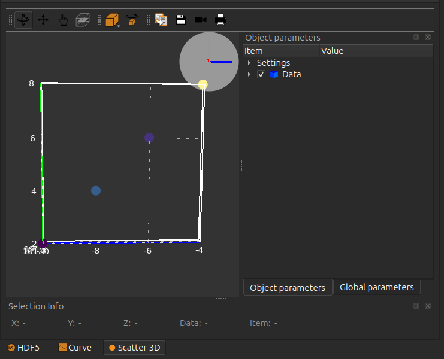

Writing HDF5 groups to produce specific plots in silx view
==========================================================

.. image:: img/nxcurve.png
    :width: 75%
    :align: center

In this tutorial, you will write HDF5 groups describing data relationships so that ``silx view`` produces specific plots: curve, image, or scatter plots whose axes, labels and errors can be extracted automatically from the group.

To follow the tutorial, you need to be able to:

- understand the concepts of *group*, *dataset* and *attribute* in HDF5
- use the *h5py* library to write HDF5 data.

You can find some information on these topics at the beginning of the
:doc:`io` tutorial.

NeXus Data Format
-----------------

So that ``silx`` produces the specific plots, the relationships between the different datasets must be described according to the `NeXus standard <https://www.nexusformat.org/>`_.

NeXus is a common data format for neutron, x-ray, and muon science. The NeXus format can be applied to HDF5 groups by adding a ``NX_class`` attribute to implement `NeXus base classes <https://manual.nexusformat.org/classes/base_classes/index.html>`_.

NeXus files are often structured this way:

- The file root is defined as `NXroot <https://manual.nexusformat.org/classes/base_classes/NXroot.html>`_ (``NX_class`` attribute set to ``NXroot``, often omitted)
- The file root contains `NXentry <https://manual.nexusformat.org/classes/base_classes/NXentry.html>`_ groups (``NX_class`` attribute set to ``NXentry``)
- The NXentry groups contain `NXdata <https://manual.nexusformat.org/classes/base_classes/NXdata.html>`_ groups (``NX_class`` attribute set to ``NXdata``).

For example (attributes are prefixed with ``@``):

.. code-block:: text

    myfile.h5                   @NX_class = "NXroot" (often omitted)
    ├── entry_1                 @NX_class = "NXentry"
    │   ├── data_a              @NX_class = "NXdata"
    │   └── data_b              @NX_class = "NXdata"
    └── entry_2                 @NX_class = "NXentry"
        └── data_c              @NX_class = "NXdata"

The **NXdata** group is the group we will write. It describes the data to be plotted and the related dimension scales.

Creating a basic NXdata
-----------------------

.. note::

    From now on, attributes will be written with a leading ``@``.

To create a ``NXdata`` group, create an HDF5 group with an attribute ``@NX_class`` set to ``NXdata``.

The datasets needed for the plot will be added to the group while the attributes of the group define the relationship between the datasets.

Signal
++++++

The ``@signal`` attribute of the ``NXdata`` group contains the name of the dataset inside the group containing the data to be plotted.

A ``NXdata`` group needs at least a **signal** dataset to produce a plot.

Axes
++++

Even though this is optional, ``NXdata`` can also contain datasets to be used as *dimension scales*. The list of those dataset names should be added to the ``@axes`` attribute of the ``NXdata`` group.

The number of names should match the number of dimensions of the signal data. If there is no matching dataset for a particular dimension, a ``"."`` should be written in place of the dataset name.

The axis dataset should be a 1D dataset, whose length matches the size of the corresponding signal dimension.

Auxiliary signals
+++++++++++++++++

The ``NXdata`` group can optionally contain datasets that should be displayed along the main signal, called **auxiliary signals**.

The corresponding dataset names should be added to the ``@auxiliary_signals`` attribute of the ``NXdata`` group.

There can be any number of auxiliary signals (even none) but all must have the same shape as the main signal (whose name is contained in the ``@signal`` attribute).

Default plots
+++++++++++++

``silx view`` will produce a plot when opening a NXdata group. This plot can also be produced when opening the parent of the NXdata group (often ``NXentry``) by setting the ``NXdata`` group as the default group.

For this, the parent group should have a ``@default`` attribute that contains the relative path to the ``NXdata`` group (e.g. its name if the ``NXdata`` group is a direct child).

Default groups can be defined up to the file root to produce a plot when opening the file in ``silx view``.

See the section below for some examples.

Examples of NXdata with h5py
----------------------------

A curve
+++++++

The simplest NXdata example would be a 1D signal to be plotted as a curve.

.. code-block:: python

    import h5py
    import numpy

    with h5py.File("myfile.h5", "w") as h5file:
        # Default group to plot when opening the file (optional)
        h5file.attrs["default"] = "entry"

        # It is mandatory to have at least one NXentry
        # https://manual.nexusformat.org/classes/base_classes/NXentry.html#nxentry
        entry = h5file.create_group("entry")
        entry.attrs["NX_class"] = "NXentry"
        # Default group to plot when opening the entry (optional)
        entry.attrs["default"] = "my_curve"

        nxdata = entry.create_group("my_curve")
        nxdata.attrs["NX_class"] = "NXdata"
        nxdata.attrs["signal"] = "y"
        ds = nxdata.create_dataset("y", data=numpy.array([0.1, 0.2, 0.15, 0.44]))

        # Add units (optional)
        ds.attrs["units"] = "mm"

        # Add an axis (optional)
        nxdata.attrs["axes"] = ["x"]
        ds = nxdata.create_dataset("x", data=numpy.array([101.1, 101.2, 101.3, 101.4]))
        ds.attrs["units"] = "deg"

        # Add additional curves with auxiliary signals (optional)
        nxdata.create_dataset("y2", data=numpy.array([0.2, 0.4, 0.3, 0.88]))
        nxdata.create_dataset("y3", data=numpy.array([1, 0.7, 0.4, 0.1]))
        nxdata.attrs["auxiliary_signals"] = ["y2", "y3"]

The resulting file has the following structure (attributes are prefixed with ``@``, datasets show their dtype and shape):

.. code-block:: text

    myfile.h5                       @default = "entry"
    └── entry                       @NX_class = "NXentry"
        │                           @default = "my_curve"
        └── my_curve                @NX_class = "NXdata"
            │                       @signal = "y"
            │                       @axes = ["x"]
            │                       @auxiliary_signals = ["y2", "y3"]
            ├── x    float64 (4,)   @units = "deg"
            ├── y    float64 (4,)   @units = "mm"
            ├── y2   float64 (4,)
            └── y3   float64 (4,)

This will give the following plot in ``silx view``:

.. image:: img/nxcurve.png

A 2D scatter plot
+++++++++++++++++

A scatter plot is the only case for which we can have more axes than
there are signal dimensions. The signal is 1D, and there can be any
number of axes with the same number of values as the signal.

Silx supports 2D and 3D scatters.

To generate a 2D scatter plot:

.. code-block:: python

    import h5py
    import numpy

    with h5py.File("myfile.h5", "w") as h5file:
        h5file.attrs["default"] = "entry"

        entry = h5file.create_group("entry")
        entry.attrs["NX_class"] = "NXentry"
        entry.attrs["default"] = "my_scatter"

        nxdata = entry.create_group("my_scatter")
        nxdata.attrs["NX_class"] = "NXdata"
        nxdata.attrs["signal"] = "values"
        nxdata.attrs["axes"] = ["x", "y"]
        nxdata.create_dataset("values", data=numpy.array([0.1, 0.2, 0.15, 0.44]))
        nxdata.create_dataset("x", data=numpy.array([101.1, 101.2, 101.3, 101.4]))
        nxdata.create_dataset("y", data=numpy.array([2, 4, 6, 8]))

.. code-block:: text

    myfile.h5                       @default = "entry"
    └── entry                       @NX_class = "NXentry"
        │                           @default = "my_scatter"
        └── my_scatter              @NX_class = "NXdata"
            │                       @signal = "values"
            │                       @axes = ["x", "y"]
            ├── values   float64 (4,)
            ├── x        float64 (4,)
            └── y        int64   (4,)

Again, in ``silx view``:

.. image:: img/nxscatter.png

A 3D scatter plot
+++++++++++++++++

A 3D scatter plot can be generated likewise

.. code-block:: python

    import h5py
    import numpy

    with h5py.File("myfile.h5", "w") as h5file:
        h5file.attrs["default"] = "entry"

        entry = h5file.create_group("entry")
        entry.attrs["NX_class"] = "NXentry"
        entry.attrs["default"] = "my_3D_scatter"

        nxdata = entry.create_group("my_3D_scatter")
        nxdata.attrs["NX_class"] = "NXdata"
        nxdata.attrs["signal"] = "values"
        nxdata.attrs["axes"] = ["x", "y", "z"]
        nxdata.create_dataset("values", data=numpy.array([0.1, 0.2, 0.15, 0.44]))
        nxdata.create_dataset("x", data=numpy.array([101.1, 101.2, 101.3, 101.4]))
        nxdata.create_dataset("y", data=numpy.array([2, 4, 6, 8]))
        nxdata.create_dataset("z", data=numpy.array([-10, -8, -6, -4]))

.. code-block:: text

    myfile.h5                       @default = "entry"
    └── entry                       @NX_class = "NXentry"
        │                           @default = "my_3D_scatter"
        └── my_3D_scatter           @NX_class = "NXdata"
            │                       @signal = "values"
            │                       @axes = ["x", "y", "z"]
            ├── values   float64 (4,)
            ├── x        float64 (4,)
            ├── y        int64   (4,)
            └── z        int64   (4,)

.. note::

    When producing the 3D scatter plot, ``silx view`` will scale the markers according to the first auxiliary signal.

    .. code-block:: python

        nxdata.create_dataset("sizes", data=numpy.array([2, 4, 4, 2]))
        nxdata.attrs["auxiliary_signals"] = ["sizes"]

    If there is no auxiliary signal, all markers will have the same size.

A stack of images
+++++++++++++++++

In case of a stack, the first axis corresponds to stack indices and may not be represented by a dataset.

In this case, we use ``.`` as a placeholder in ``axes`` for this dimension:

.. code-block:: python

    import h5py
    import numpy

    with h5py.File("myfile.h5", "w") as h5file:
        h5file.attrs["default"] = "entry"

        entry = h5file.create_group("entry")
        entry.attrs["NX_class"] = "NXentry"
        entry.attrs["default"] = "image"

        nxdata = entry.create_group("image")
        nxdata.attrs["NX_class"] = "NXdata"
        nxdata.attrs["signal"] = "frames"
        nxdata.attrs["axes"] = [".", "y", "x"]
        # 2 frames of size 3 rows x 4 columns
        signal = nxdata.create_dataset(
            "frames",
            data=numpy.array(
                [
                    [[1.0, 1.1, 1.2, 1.3], [1.4, 1.5, 1.6, 1.7], [1.8, 1.9, 2.0, 2.1]],
                    [[8.0, 8.1, 8.2, 8.3], [8.4, 8.5, 8.6, 8.7], [8.8, 8.9, 9.0, 9.1]],
                ]
            ),
        )
        x = nxdata.create_dataset("x", data=numpy.array([0.1, 0.2, 0.3, 0.4]))
        x.attrs["units"] = "mm"
        y = nxdata.create_dataset("y", data=numpy.array([2, 4, 6]))
        y.attrs["units"] = "s"

.. code-block:: text

    myfile.h5                           @default = "entry"
    └── entry                           @NX_class = "NXentry"
        │                               @default = "image"
        └── image                       @NX_class = "NXdata"
            │                           @signal = "frames"
            │                           @axes = [".", "y", "x"]
            ├── frames   float64 (2, 3, 4)
            ├── x        float64 (4,)       @units = "mm"
            └── y        int64   (3,)       @units = "s"

.. image:: img/nximage.png

.. note::

    If the image axes have the same ``units`` or both have no ``units``, the image aspect ratio will be kept.

    In the example above, the two axes ``x`` and ``y`` have different ``units`` so that the image aspect ratio is not conserved.

Other supported NXdata features
-------------------------------

``@units``
++++++++++

This attribute can be added to signal or axis datasets.

If present, the units will be added to the name of the axis producing ``name (units)`` as the label.

When displaying an image, the aspect ratio is preserved if both axes have the same ``@units``.

``@long_name``
++++++++++++++

.. warning::

    Takes precedence over ``@units`` for axis labels or plot titles.

This attribute can be added to signal or axis datasets.

If present, the ``@long_name`` of the signal will be used as label of the Y axis if displayed as a curve or as plot title (for images).

If present, the ``@long_name`` of an axis dataset will be used as label of the corresponding axis.

``@title``
++++++++++

.. warning::

    Takes precedence over ``@units`` or ``@long_name`` for plot titles.

This attribute can be added to the ``NXdata`` group. If present, it is used as the plot title.

``@interpretation``
+++++++++++++++++++

This attribute can be added to the signal dataset. ``silx`` uses this attribute to decide what visualization to show when visualizing the NXdata group.

It can take the following values with the following effect:

- ``spectrum``: the data will be preferably shown as curves, even if it has more than 1 dimension.
- ``image``: the data will be preferably shown as images, even if it has more than 2 dimensions.
- ``rgb-image``/``rgba-image``: the last dimension of the data must be interpreted as RGB channels. The data must therefore have at least 3 dimensions (2D image with channel) and the last dimension must be of size 3 (RGB) or 4 (RGBA).

``<signal>_errors``
+++++++++++++++++++

This dataset can be added to the ``NXdata`` group. Its name must be the signal dataset name with ``_errors`` appended to it (e.g. for a signal named ``y``, the error dataset must be named ``y_errors``). It must have the same shape as the signal dataset.

If present, the dataset will be used to produce vertical error bars when plotting the signal as a curve.

Auxiliary signals get their errors the same way, from a dataset named after each auxiliary signal.

``<axis>_errors``
+++++++++++++++++

This dataset can be added to the ``NXdata`` group, for any axis dataset. It must have the same size as the corresponding axis and its name must be the axis dataset name with ``_errors`` appended to it (e.g for an axis named ``pressure``, the error dataset must be named ``pressure_errors``).

If present, the dataset will be used to produce horizontal error bars when plotting the signal as a curve with the corresponding axis as X axis.

``@default_slice``
++++++++++++++++++

This attribute can be added to the ``NXdata`` group when the signal has more dimensions than the ones displayed.

If present, it will define the slice that is initially shown. The number of entries should match the signal dimension:

- ``"."`` for the dimensions to display.
- An index for the other dimensions

For example, a ``NXdata`` group with a 3D signal and a ``@default_slice`` set to ``["1", ".", "."]`` initially shows the slice `1,:,:` of the signal.

If the number of unsliced dimensions does not match the display dimensions of the visualization (2 for image, 1 for curve), the default slice will not be applied.

.. note::

    For axis datasets containing strings, it is possible to replace the index by the string value.

``@first_good`` and ``@last_good``
++++++++++++++++++++++++++++++++++

These attributes can be added to axis datasets.

If present, the axis will be only considered over the defined range of indices. 

This means that:

- The axis can only be sliced in this range
- When using this axis for display, it will be displayed only on this range and the corresponding signal dimension must **have as many points as this range**.

``@SILX_style``
+++++++++++++++

.. warning::

    This attribute is not part of the NeXus standard.

This attribute can be added to the ``NXdata`` group. It contains a JSON string defining how to display the data. The following keys are supported:

- ``signal_scale_type``: the scale of the signal values. One of ``"linear"``, ``"log"`` or ``"asinh"``.
- ``axes_scale_types``: the scale of each axis (same values as above), as a list with one entry per axis in ``@axes``.

.. code-block:: python

    import json

    nxdata.attrs["SILX_style"] = json.dumps(
        {"signal_scale_type": "log", "axes_scale_types": ["linear"]}
    )

