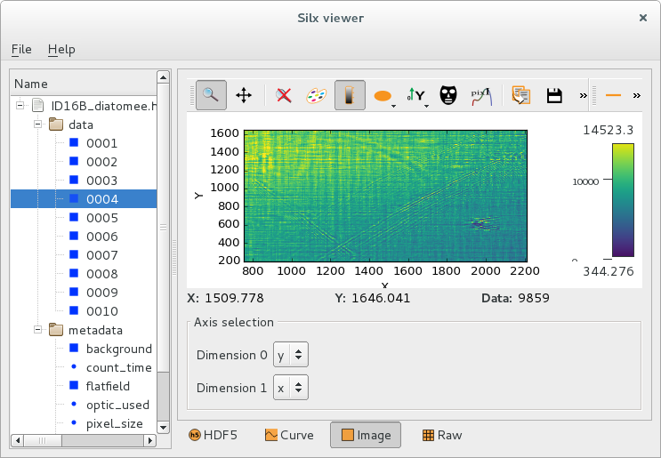
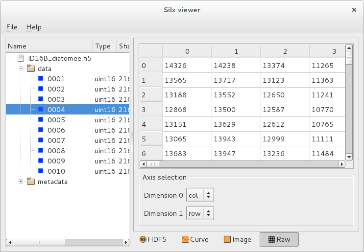
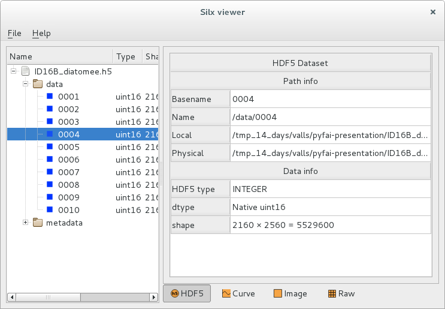

.. _silx-view:

silx view
=========

.. figure:: http://www.silx.org/doc/silx/img/silx-view-v1-0.gif
   :align: center

Purpose
-------

The *silx view* command is provided to open data files
in a graphical user interface. It allows to select a particular
piece of data or a particular header in structured data formats,
and to view this data in plot widgets or in simple table views.

.. list-table::
   :widths: 1 2

   * - |imgViewImg|
     - Image view
   * - |imgViewTable|
     - Viewing raw data as values in a table
   * - |imgViewHdf5|
     - Viewing metadata and HDF5 attributes

Custom plot selection
---------------------

The *Plot selection* window (*Views* → *Plot selection*) plots 1D datasets
against each other, whatever the file or the HDF5 group they come from:
one dataset can be used as X and one or more datasets are plotted as Y curves.
Datasets are selected by drag and drop from the HDF5 tree.

See :ref:`silx-view-plot-selection` for details.

Command line
------------

.. code-block:: none

    silx view [-h] [--slices SLICES [SLICES ...]] [--debug] [--use-opengl-plot] [-f] [--hdf5-file-locking] [files ...]

Options
-------

.. code-block:: none

  -h, --help            show this help message and exit
  --slices SLICES [SLICES ...]
                        List of slice indices to open (Only for dataset)
  --debug               Set logging system in debug mode
  --use-opengl-plot     Use OpenGL for plots (instead of matplotlib)
  -f, --fresh           Start the application using new fresh user preferences
  --hdf5-file-locking   Start the application with HDF5 file locking enabled (it is disabled by
                        default)

Examples
--------

Open file(s)
............

.. code-block:: none

    silx view 31oct98.dat
    silx view *.edf
    silx view myfile.h5

Open HDF5 dataset(s)
....................

Using the HDF5 path to the dataset:

.. code-block:: none

    silx view my_hdf5_file.h5::entry/instrument/detector/data

Using wildcard:

.. code-block:: none

   silx view my_hdf5_file.h5::entry/*/data

Open HDF5 dataset slices
........................

Open first and last slices of datasets:

.. code-block:: none

    silx view my_hdf5_file.h5::entry/*/data --slices 0 -1
